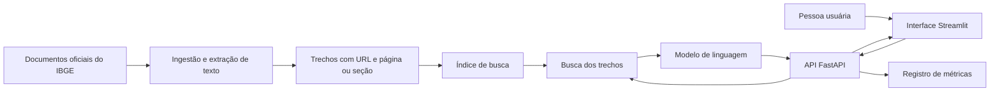

# Arquitetura proposta

Este documento descreve a arquitetura do projeto. A ingestão já é executável; busca, API e interface ainda são planejadas.

## O que é RAG neste projeto

RAG (*Retrieval-Augmented Generation*) combina busca em documentos com geração de texto. Primeiro, o sistema encontra trechos do IBGE relacionados à pergunta. Depois, envia apenas esses trechos e a pergunta ao modelo de linguagem. A resposta exibe as fontes usadas. Se os trechos não forem suficientes, o sistema deve indicar a limitação.



A ingestão ocorre quando o corpus é criado ou atualizado. Busca e geração ocorrem a cada pergunta. Perguntas numéricas por município ficarão para uma segunda etapa, com consulta estruturada ao SIDRA.

## Estrutura de pastas prevista

```text
.
├── README.md
├── docs/
│   └── architecture.md
├── pyproject.toml                 # Dependências e comandos do projeto
├── src/censo_rag/
│   ├── ingestion.py               # Extrai texto e preserva a origem
│   ├── chunking.py                # Divide documentos em trechos
│   ├── retrieval.py               # Busca lexical e semântica
│   ├── generation.py              # Monta o contexto e gera a resposta
│   ├── metrics.py                 # Latência, tokens e custo estimado
│   ├── schemas.py                 # Formatos de pergunta, resposta e fontes
│   └── api.py                     # Endpoint HTTP
├── ui/
│   └── app.py                     # Interface Streamlit
├── scripts/
│   ├── ingest.py                  # Recria o índice
│   └── evaluate.py                # Executa perguntas de avaliação
├── eval/
│   └── questions.jsonl           # Perguntas e fontes esperadas
└── tests/                         # Testes do pipeline e da API
```

`data/` guardará downloads, índices e registros locais e ficará fora do Git quando contiver arquivos grandes ou dados de uso. `src/censo_rag/` concentra a lógica para que API, interface e avaliação usem exatamente o mesmo fluxo.

## Interface

Haverá um frontend em Streamlit, escrito em Python. A página principal terá um campo de pergunta, resposta, links para as fontes e os trechos recuperados. Uma área de detalhes mostrará tempo total, tempo de busca, tempo de geração, modelo e tokens da consulta. Um painel simples poderá agregar as consultas locais para comparar versões. A API FastAPI permitirá testar o sistema sem a interface e exporá documentação interativa.

## Como medir

Cada pergunta terá um identificador e um registro com:

| Campo | Significado |
| --- | --- |
| `retrieval_ms` | Tempo para encontrar os trechos |
| `generation_ms` | Tempo da chamada ao modelo, incluindo rede |
| `total_ms` | Tempo da API do início ao fim |
| `input_tokens` / `output_tokens` | Consumo informado pelo provedor do modelo, quando disponível |
| `embedding_tokens` | Consumo da consulta de embeddings, se o serviço fornecer esse dado |
| `model` e `index_version` | Versões usadas para reproduzir a consulta |
| `source_ids` | Trechos enviados ao modelo |
| `estimated_cost` | Cálculo a partir dos tokens e de uma tabela de preços configurável |

Usaremos `time.perf_counter()` antes e depois de cada etapa. A interface também pode medir seu próprio tempo de ponta a ponta; esse número inclui o caminho entre navegador e API e não deve ser confundido com `total_ms`. Nas comparações de desempenho, executaremos várias perguntas, distinguiremos a primeira execução das seguintes e reportaremos mediana e percentil 95, além dos casos lentos.

Os tokens devem vir, de preferência, dos metadados da resposta do provedor; contar palavras ou caracteres não fornece o consumo real. Se um provedor não informar uso, o campo ficará como desconhecido ou será marcado explicitamente como estimativa. O custo será sempre identificado como estimado, porque preços podem mudar e alguns provedores têm regras distintas para cache, embeddings e geração.

## Como avaliar qualidade

O arquivo `eval/questions.jsonl` terá perguntas respondíveis, ambíguas e fora do escopo, com a fonte esperada e o comportamento esperado. A avaliação medirá:

1. `recall@5`: em quantas perguntas a fonte correta aparece nos cinco primeiros trechos.
2. Correção da resposta e suporte nas fontes, revisados com critérios documentados.
3. Abstenção em perguntas sem evidência suficiente.
4. Latência e tokens por pergunta e por versão do sistema.

Primeiro será implementada uma busca lexical para estabelecer uma referência. Depois entra a busca semântica; a geração só será acrescentada quando conseguirmos verificar se os trechos certos estão sendo recuperados. Isso permite identificar se uma resposta ruim veio da busca ou da geração.
